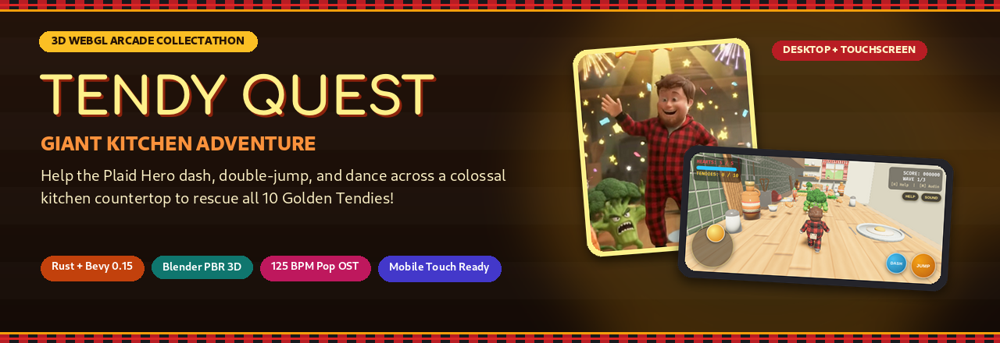
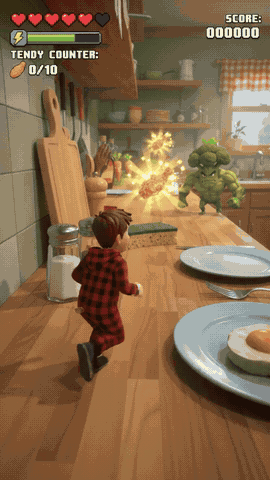

<p align="center">
  
</p>

<p align="center">
  <a href="https://sircharlesxx.github.io/tendy-quest/">
    
  </a>
</p>

<p align="center">
  <a href="https://sircharlesxx.github.io/tendy-quest/"></a>
  
  
  
  
</p>

---

## Welcome to Tendy Quest! (Eat Tendies, Grow Into a Kaiju)

Start shrunk down to miniature **17cm Tiny Toy** size (`0.55` scale) right next to a stack of pancakes on the **Breakfast Island** of a **1,200 sq ft Open-Concept Apartment**. As **the Plaid Hero**, you've got cozy red-and-black buffalo plaid pajamas, springy **Double-Jumps**, a speedy **Belly Dash**, and a two-part adventure:

1. **Level 1 (The Apartment):** Eat all **12 Golden Tendies** to grow from **17cm** to **180cm Full Adult Size** (`6.0` scale), bowl over grumpy veggies, and swing open the **Giant Refrigerator**!
2. **Level 2 (Cedar Rapids & the Local Pub):** Step outside into **Cedar Rapids** with **20 Hearts**, recruit your crew of **four friends** through dramatic anime/kung-fu cutscenes and share a smoke break with **the scooter vendor** (the city tendies stay locked until all five are done), tear up **3 Electric Scooter Stunt Circuits**, collect **50 City Tendies** to grow into a **6500cm Skyscraper Kaiju**, and smash **the Giant Pickled Garlic boss**!

<table>
  <tr>
    <td valign="top">
      <h3>Level 1: Apartment Eat-to-Grow</h3>
      <ul>
        <li><strong>Hunt 12 Golden Tendies Across 1,200 Sq Ft:</strong> Leap around the South Breakfast Island, bound down to the hardwood floor, weave through the Living Room and Dining Area, and climb up the North Kitchen Countertop (<code>+150 pts</code> per tendy, plus a <code>+1,000 pts</code> Big Boy bonus at <code>12/12</code>).</li>
        <li><strong>Grow From Little Guy to 180cm Big Boy:</strong> Level up from <strong>Tiny Toy</strong> (<code>0–3</code> Tendies) &rarr; <strong>Counter Climber</strong> (<code>4–7</code>) &rarr; <strong>Kid Size</strong> (<code>8–11</code>) &rarr; <strong>180cm Big Boy</strong> (<code>12/12</code>).</li>
        <li><strong>Turn the Tables on Veggies:</strong> Past <code>2.2</code> scale, the hero shrugs off sticky Kale Slime puddles and bowls Broccoli Brutes &amp; Carrot Lancers across the room on contact (<code>+250 pts</code>)!</li>
        <li><strong>Open the Giant Refrigerator:</strong> At full <strong>180cm</strong> height, walk up to the towering fridge on the north wall and yank its door wide open (<code>+5,000 pts</code>) to head out to Cedar Rapids!</li>
        <li><strong>Navigate Apartment Clutter &amp; 3 Veggie Waves:</strong> Hop over scattered <strong>Ricos Nacho Cheese Cups</strong>, wireless <strong>Game Controllers</strong>, and floor <strong>Headphones</strong> while veggie waves spawn every 16 seconds.</li>
      </ul>
    </td>
    <td width="250" align="center" valign="middle">
      
      <br/>
      <sub><em>The Plaid Hero gearing up for snack time</em></sub>
    </td>
  </tr>
</table>

### Growth Milestones (Level 1)

| Tendies Eaten | Size Tier | Hero's Height | What Changes |
| :---: | :--- | :--- | :--- |
| `0 – 3` | **Tiny Toy** | Starts at **17cm** (`0.55` scale) | Cozy bite-sized adventurer dodging towering forks and giant pancakes. |
| `4 – 7` | **Counter Climber** | Climbing upward | Faster stride, higher jumps, and wider reach across apartment furniture. |
| `8 – 11` | **Kid Size** | Past `2.2` scale | Sticky Kale Slime puddles stop slowing you down, and veggies get knocked flying! |
| `12 / 12` | **ADULT - OPEN FRIDGE!** | **180cm Big Boy** (`6.0` scale) | Full grown! Tall enough to reach the handle on the **Giant Refrigerator**. |

---

## Level 2: Cedar Rapids, the Local Pub & The Kaiju Showdown

<p align="center">
  
</p>

Once you conquer the Giant Refrigerator, the hero heads out into **Cedar Rapids** (`20 Hearts`), reunites the crew at **the local pub**, gathers **50 City Tendies**, hits scooter stunts, and takes down **the Giant Pickled Garlic boss**:

- **Crew First:** The city tendies stay dimmed and locked until the hero has found and recruited **all four crew members**, who are scattered around Cedar Rapids (each waits on a sidewalk somewhere in town, at a new random spot every time the city is built), and shared a smoke break with **the scooter vendor** in **the local pub**, which stands on its own block with its door facing the avenue. The radar doesn't give the crew away: when the hero gets within about 35 m of one, they call out to him (a hint, a chime, and a spoken line), a small green marker floats over their head, and from then on a pulsing green dot shows them on the radar. The pub keeps an amber radar marker until the smoke break with the scooter vendor, and the HUD objective lists who is still missing. Until then the garlic boss is only warming up: her garlic stings but can't take the hero below 10 hearts. Once all five are done the tendies light up, the hero starts growing, and the real fight begins. The pub keeps its size, so a grown hero simply towers over it.

- **Recruitable Crew & Dramatic Cutscenes (Full Story, Skippable):** Hold `Enter`, gamepad `Start`, or the touch **SKIP** button for a moment to skip any cutscene; you land exactly where watching it out would leave you. Every character speaks with their own browser voice, pitch, and pace.
  - **The Crew:** A crew of four friends, each recruited through their own dramatic cutscene (heated arguments, a kung-fu duel, and a high-speed **DBZ-style** city teleportation & building-destruction fight among them), who then join and follow the hero and team up to wreck the final boss!
- **Beer Tower (the Pub):** The beer tower in the back corner of the pub glows amber from the start. Walk up at normal size and press `F` / `E` (gamepad `X`, or tap the **DRINK A BEER** button) to drink: **+3 hearts**, but the hero is **drunk for 20 s** (more beers add time, up to 45 s; one beer every 4 s). A drunk hero gets a slow, rolling camera sway (different from the scooter vendor's smoke-break high), a `DRUNK` timer on the HUD, and a wandering drift when walking or steering the scooter.
- **Driver's License & Cars:** No car can be driven until the hero finds the **driver's license** card hidden at a random kerbside spot each run (a spinning card with a blue beacon; walk into it). Until then every car, including the one random **parked car** with its **DRIVE** prompt, answers "Sorry, you don't have a license", and after the first refusal the radar shows the card with a pulsing blue marker. With the license the traffic cars can be hijacked with `F` / `E` as before, and the parked car drives like any of them (leave it anywhere and it stays parked there). The license is saved in the checkpoint, kept on retries, and carries into free roam.
- **The RIVER STAR Ferris Wheel:** A 44 m observation wheel turns slowly on a boardwalk pier in the river corner of the city (the lilac ring on the radar), lit with rows of bulbs after dark. At normal size, climb onto its boarding platform and press `F` / `E` (gamepad `X`, or tap the **RIDE THE WHEEL** button): the next gondola comes down, the hero steps in and rides two laps (about 48 s each) with the camera inside the gondola looking out over the city. Look around freely, scroll or pinch out for an outside view of the gondola, and press `F` / `E` again to hop off when the gondola is next back at the platform. While riding, the hero can't be hurt and the crew wait by the pier.
- **Electric Scooter & 3 Stunt Circuits:** Unlock your **Veo** scooter via the phone (`P`), ride freely across the city, and hit **3 Stunt Circuits** packed with launch ramps, boost pads, glowing boost rings, and mid-air backflips.
- **Skate Park:** Greene Square is now a concrete skate plaza, and the lot across the street to its south holds the transition section, joined by a painted crossing. Ride the 3.4 m **half pipe** (speed turns into height, holding forward on the way down a wall pumps, and the coping pops you into vert air and back down the wall), launch off the two-way **jump box** in the middle of the square, and jump onto the **rails and ledges** (a flat rail, a kinked rail, a hubba ledge, a manual pad, a bench ledge, a long rail with its own kicker, even the coping) to **grind**: the scooter locks on and slides with sparks, steering keeps your balance, and jump gets you off. In the air hold jump to **backflip**, tap it for a **tailwhip**, and steer to **spin**. Airs, grinds and flips chain into the stunt combo (the same trick twice in a row earns less), and the neon sign over the half pipe shows the best line. In the park the scooter tops out at park speed unless a stunt-circuit boost is running, and on foot the hero can walk and climb around the pieces. Test link: `?free_roam=1`, the park is on the radar's pink squares.
- **Skyscraper Kaiju Finale, Turn-Based 5-Hero RPG Lexie Showdown & Cedar Rapids Dusk Meltdown Ending:** Grow up to **6500cm** (`50/50` City Tendies) and engage **Giant Lexie** to launch into a full **Turn-Based 5-Hero RPG Battle** (`GameState::LexieBattle`, test link `?lexie_battle=1`) set to a 156 BPM symphonic JRPG final-boss theme! All five heroes—**Stan** (*ESXi Restore* + *The Cycle* Sonic spin-dash & 4-hour nap), **Glenn** (*Power Punch* + *Powerbomb*), **Nate** (*Lazy Eye Stun* + *Gum Bubble Pop*), **Derek** (*Elbow Sweat* + *Kamehameha*), and **TJ** (*Broken Ankle Complain Stun* + *Spirit Bomb* asking Cedar Rapids for all the world's golden tendies)—battle alongside rhythmic RPG idle sway and damage recoil reactions. Defeating Lexie triggers the John Carpenter's *The Thing*-style practical-effects meltdown where she splits open and melts into steaming brine before **the hero and all four pub crew members**, framed against a full **Cedar Rapids dusk cityscape** (illuminated downtown skyline towers, the Cedar River bridge, and a distant burning Quaker Oats industrial mill on the horizon).
- **Tendy Palace Casino Level & Persistent Tendy Wendies (`TW`):** Step up to **Maria** the bartender inside **Pub 217** and press **`ORDER 10 BEERS`** (`Space` / tap) to trigger an animated hangout cutscene (when squadmates are connected in your shard, you can choose **Teleport Everyone** to bring the whole squad through the portal or **Go Alone**)—after debating classic movies (including *Teenage Mutant Ninja Turtles*) around the table while girls casually head into the women's restroom in the background, the boys peer around the beer tower investigating the restroom door just before a magic portal blows open and pulls the crew straight into the dedicated **Tendy Palace Casino** level! Inside the grand hall you can hit the central **Blackjack Table** (6-deck shoe, `Deal`, `Hit`, `Stand`, `Double`, 3:2 natural payouts, **Lucky Pairs** & **5-Card Charlie** bonuses, **VIP tiers & session stats**, and dynamic table-level, macro reveal, and win pull-back camera angles), spin two banks of 5-payline 3D **Slot Machines**—**Buffalo Stampede** (Wild Buffalo 2x combos & 30x Stampede jackpots) and **Lucky Ladies** (custom illustrated pin-up portrait reels & cabinets)—featuring **Hold** reels, a **Free Spins** meter, volumetric 3D paylines, and an anticipation camera, visit the **Cashier** (with a free `+25 TW` stipend whenever your balance drops below `25 TW`), or walk through the South **Pub 217 Return Portal** back into Cedar Rapids. All wagers use **Tendy Wendies (`TW`)**, earned from Golden Tendies (`+2 TW` in the apartment, `+5 TW` in Cedar Rapids, `+100 TW` for defeating the final boss) and persisted in `localStorage` across sessions and future features.
- **Free Mode & Post-Game Free Roam:** Defeating the final boss unlocks and persists post-game **Free Mode** immediately upon victory (`Continue` on the victory screen, or reload later), AND **`FREE MODE [F]`** on the Start Menu lets you jump straight into Cedar Rapids anytime without overwriting an unfinished story checkpoint (normal 180cm size, no boss, scooter unlocked for stunt circuits & skate park, score-only city tendies). Test link: `?free_roam=1`.

---

## Play Anywhere — Desktop, Controller & Mobile Touch

Hop straight in with zero downloads! Compiled to Rust + WebAssembly + WebGL2 with responsive `100dvh` portrait/landscape layouts, scroll-wheel zoom on desktop, W3C Gamepad support, and mobile touch controls:

<p align="center">
  
</p>

---

## Meet the Plaid Hero, Sauce Buffs & the Grumpy Veggies

<p align="center">
  
</p>

| Entity | Role | Mechanics & Stats |
| :--- | :--- | :--- |
| **The Plaid Hero** | Playable Hero | Starts with **5 Hearts** at **17cm** in Level 1 (up to **180cm**) and **20 Hearts** in Level 2 (growing up to **6500cm Skyscraper Kaiju**). Features **Double-Jump**, **Belly Dash**, Estus healing, and scooter stunts. |
| **Golden Tendy** | Growth Snack | **12** in the Apartment (`+150 pts` each) and about **70** across Cedar Rapids (stunt trails included), of which **50** fuel the hero's kaiju growth. |
| **Giant Refrigerator** | Level 1 Goal | Towering fridge by the North Kitchen wall—open at **180cm** (`+5,000 pts`) to unlock Cedar Rapids. |
| **Honey Mustard Cup** | Speed Buff | Grants **10 seconds** of **1.75&times; movement speed** for zooming across the floor. |
| **Ranch Bubble Shield** | Defense Buff | Wraps the hero in a creamy **1-hit protective bubble** that absorbs veggie damage and knocks attackers back. |
| **Broccoli Brute** | Heavy Tank | Patrols key apartment zones at `2.2` speed and charges at `3.8` speed whenever the hero enters its `9.0m` range. |
| **Carrot Lancer** | Fast Charger | Locks on within `10.5m`, telegraphs for `0.8s`, and lunges forward at `11.5` speed with a 4-tine fork! |
| **Kale Slime** | Floor Hazard | Glides around leaving sticky **Fiber Puddles** every `1.4s` that slow down the tiny hero until he grows past them. |
| **The Crew (Four Friends)** | Cedar Rapids Crew | Encountered in Level 2 & the local pub; each joins and follows the hero after their cutscene and appears in the finale! |
| **Giant Pickled Garlic Boss** | Final Kaiju Boss | Skyscraper-scale boss terrorizing Cedar Rapids with spiral-powered attacks and pickled garlic horror. |

---

## Controls Guide

| Desktop (Mouse + Keyboard) | PC Controller (Gamepad) | Mobile / Tablet (Touch Screen) |
| :--- | :--- | :--- |
| <ul><li>**Move / Steer:** `W A S D` or Arrow Keys</li><li>**3D Camera Look:** Move Mouse (`Click` locks cursor)</li><li>**Camera Zoom:** Mouse Scroll Wheel</li><li>**Jump / Double-Jump:** `Space`</li><li>**Belly Dash / Boost:** `Shift` (Left or Right)</li><li>**Lightsaber (saber fights):** tap `Click` / `J` / `X` to slash, hold it to charge a heavy slash, `Shift` dodge roll</li><li>**Saber Block:** hold `Right-Click` or `R` (raise it just as a hit lands for a Perfect Block)</li><li>**Strafe:** hold `V` (automatic while blocking or locked on)</li><li>**Lock-On:** `Tab`</li><li>**Mount / Dismount Scooter or Car:** `F`</li><li>**Ride the Ferris Wheel / Hop Off at the Bottom:** `F` on its boarding platform (scroll to switch between the gondola and outside views)</li><li>**Scooter Jump:** `Space` while riding (hold `Space` in the air to backflip)</li><li>**Skate Park:** hold `W` dropping down a transition to pump, `Space` onto a rail or ledge to grind (`A` / `D` keep balance, `Space` jumps off), in the air hold `Space` to backflip, tap it for a tailwhip, `A` / `D` to spin</li><li>**Phone / Veo Unlock:** `P`</li><li>**Estus Heal:** `Q`</li><li>**Pause Menu (controls, sound, restart, clear cache, clear save, online/solo):** `Esc` or `H`</li><li>**Mute / Unmute Audio:** `M`</li><li>**Skip Cutscene:** hold `Enter`</li><li>**Start / Play Again:** `Space`, `Enter`, or `Click`</li></ul> | <ul><li>**Move / Steer:** Left Stick or D-Pad</li><li>**3D Camera Look:** Right Stick</li><li>**Jump / Double-Jump / Confirm:** `A` (`Cross`)</li><li>**Belly Dash / Boost:** `B` (`Circle`)</li><li>**Mount / Dismount Scooter:** `X` (`Square`)</li><li>**Ride the Ferris Wheel / Hop Off:** `X` (`Square`) on its boarding platform</li><li>**Scooter Jump:** `A` (`Cross`) while riding (hold it in the air to backflip)</li><li>**Skate Park:** Left Stick forward on the way down a wall to pump, `A` onto rails to grind and to jump off, hold `A` in the air to backflip, tap it for a tailwhip, Left Stick sideways to spin and balance</li><li>**Estus Heal:** `Y` (`Triangle`)</li><li>**Phone / Veo Unlock:** `LB` (`L1`)</li><li>**Attack:** `RB` (`R1`) or `RT` (`R2`), hold to charge a heavy slash</li><li>**Saber Block (hold, boss fights):** `LT` (`L2`)</li><li>**Strafe (hold):** `L3` (left stick click)</li><li>**Lock-On:** `R3` (right stick click)</li><li>**Pause Menu:** `Start` / `Options` (D-Pad to select, `A` to choose, `B` to resume)</li><li>**Skip Cutscene:** hold `Start` / `Options`</li></ul> | <ul><li>**Move:** Bottom-left **Virtual Thumbstick** (full 360&deg; analog speed)</li><li>**3D Camera Look:** **Swipe / Drag** anywhere on the viewport</li><li>**Camera Zoom:** Two-finger **Pinch** (when thumbstick is released)</li><li>**Jump / Double-Jump:** Tap **JUMP**</li><li>**Scooter Jump:** Tap **JUMP** while riding</li><li>**Skate Park:** Thumbstick forward on the way down a wall to pump, tap **JUMP** onto rails to grind and to jump off, hold **JUMP** in the air to backflip, tap it for a tailwhip, steer to spin and balance</li><li>**Belly Dash:** Tap **DASH**</li><li>**Ride the Ferris Wheel / Hop Off:** Tap the **RIDE THE WHEEL** / **HOP OFF** button on its boarding platform</li><li>**Lightsaber (saber fights):** Tap **SABER** to slash, hold it to charge a heavy slash, tap **ROLL** to dodge, hold **BLOCK** to guard and strafe</li><li>**Pause Menu:** Tap **HELP**</li><li>**Mute / Unmute Audio:** Tap **SOUND**</li><li>**Skip Cutscene:** hold **SKIP**</li><li>**Start / Play Again:** Tap **anywhere** on the overlay</li></ul> |

During play a small strip of key chips in the bottom-left corner lists the controls for the current situation (Level 1, saber fights, the city on foot, scooter, car, Ferris wheel) and switches to gamepad buttons when you use a controller. The pause menu (`Esc`, `H`, `Start` or **HELP**) stops the game and shows the full list for the current situation, plus **Resume**, **Sound on/off**, **Free Roam: Online (P2P) / Solo** (in Free Mode), **Restart Level**, **Clear Cache (Keeps Save)**, and **Clear Save** (each of the last three requires a second press within 3 seconds to confirm). **Clear Cache (Keeps Save)** flushes the active Story Mode checkpoint (when not in Free Mode), unregisters Service Workers, deletes all `CacheStorage` buckets, fetches `./version.json` (`cache: "no-store"`), and reloads via `location.replace` with `_v` / `_cb` cache-busting parameters so mobile and desktop browsers pull the newest build while preserving all `localStorage` saves (checkpoint, Mom-defeated flag, Tendy Wendies `TW`, and preferences). Clear Save erases all saved progress (checkpoint, Mom-defeated flag, crew, license, the final boss win) and fades back to the title screen at Level 1 with no Continue option. If the browser releases the mouse (for example `Esc` while the cursor is locked), the game pauses; click **Resume** to lock the cursor again.

---

## Music & Sound Effects

Tendy Quest combines pre-baked stereo audio with a real-time WebAudio synthesizer and voice pipeline wired from Rust via `wasm-bindgen` (unlocked automatically on your first click, keypress, gamepad press, or tap):

- **Apartment Music & Ambience:** [`assets/audio/tendies_from_the_sun.mp3`](assets/audio/tendies_from_the_sun.mp3) and [`assets/audio/kitchen_ambience.mp3`](assets/audio/kitchen_ambience.mp3).
- **142 BPM Symphonic Metal Boss Anthem & Procedural Foley Audio:** Procedural WebAudio D Phrygian boss music, cutscene scores, and synthesized horror Foley (`flesh_tear`, `wet_squelch`, `bone_crack`, `thing_shriek`, distant `fire_roar`) in [`rust/index.html`](rust/index.html). Synthesizing these in WebAudio adds visceral finale atmosphere without bloating asset downloads, while respecting audio mute and cutscene skip.
- **Character Dialogue & Stereo SFX:** In-game TTS voice lines for the hero, the crew, and the final boss alongside stereo `.wav` sound effects (`jump`, `double_jump`, `dash`, `tendy`, `powerup`, `hit`, `shield`, `step`, `lunge`, `win`, `lose`).

---

## Tech Stack & Building from Source

- **Engine:** [Rust](https://www.rust-lang.org/) + [Bevy 0.15](https://bevyengine.org/) (`webgl2`, `bevy_gltf`, `bevy_pbr`, `bevy_ui`)
- **Web Packaging:** [`trunk`](https://trunkrs.dev/) + `wasm-bindgen` deploying static artifacts from `dist/web/` to GitHub Pages
- **3D & Media Pipeline:** Python-scripted Blender PBR `.glb` models ([`blender/build_tendy_quest_assets.py`](blender/build_tendy_quest_assets.py)), NumPy/`ffmpeg` audio synthesis ([`blender/build_tendy_quest_audio.py`](blender/build_tendy_quest_audio.py)), and Pillow/`ffmpeg` README graphics ([`blender/build_readme_graphics.py`](blender/build_readme_graphics.py))

### Prerequisites

```bash
rustup target add wasm32-unknown-unknown
cargo install trunk
```

### Run Locally in Your Browser

```bash
cd rust
trunk serve
```

### Build Production GitHub Pages Bundle (`dist/web/`)

```bash
cd rust
trunk build --release --public-url ./ --dist ../dist/web
```

### Mobile Cache-Busting & Auto-Updates

- **CI Build Stamping:** [`.github/workflows/deploy-pages.yml`](.github/workflows/deploy-pages.yml) stamps each GitHub Pages deploy's 8-character commit SHA into `dist/web/version.json` (`{"v":"<sha>"}`) and `<meta name="tq-build">` inside `dist/web/index.html`.
- **Automatic `<head>` Version Checker:** On page load and browser bfcache restore (`pageshow`), the inline `<head>` updater fetches `./version.json` with `cache: "no-store"`. When a newer deploy is detected, it unregisters Service Workers, deletes `CacheStorage` buckets, and automatically reloads once with `?_v=<sha>` (guarded by `sessionStorage.tq_reloaded_v` to prevent reload loops). Returning to a backgrounded tab (`visibilitychange`) shows a tap-to-update banner (`#tq-update-banner`) instead of interrupting mid-game.
- **Manual Refresh Option (Keeps Save):** The active build SHA is displayed in the multiplayer panel (`#mp-panel`), and desktop/mobile players can trigger a clean cache wipe anytime via **Pause Menu (`Esc` / `H` / `Start` / `HELP`) &rarr; `CLEAR CACHE (KEEPS SAVE)`**.

### Regenerate 3D Models, Audio & README Graphics (Optional)

```bash
# Regenerate all articulated PBR .glb models in assets/models/
blender --background --python blender/build_tendy_quest_assets.py

# Regenerate background music & stereo SFX in assets/audio/
python3 blender/build_tendy_quest_audio.py

# Regenerate README banners, showcase panels, city preview & GIF in assets/readme/
python3 blender/build_readme_graphics.py
```

### Full-Game Enforced Co-Op Multiplayer (Zero Servers, Auto Drop-In)

Tendy Quest runs in **enforced co-op multiplayer** across the entire adventure—from the Apartment (Level 1) and Mom's Boss Fight through Cedar Rapids, Pub 217 / Tendy Palace Casino, and the Lexie RPG Showdown—over a **zero-server distributed P2P WebRTC mesh** served straight from static GitHub Pages:

- **Level 1 Co-Op Gate & Scaled Mom Boss HP:** Clicking **`START QUEST`** drops every player into the Apartment as **Stan**, displaying the live online player count and `12/12` readiness (`ONLINE: X/4 | LVL1 READY Y/Z`). All active Level 1 players must individually eat `12/12` tendies before the **Giant Refrigerator** can be opened to start Mom's fight together. Mom's HP scales as an integer with active player count (`200 + (players - 1) * 120`: `200` for 1 player, `320` for 2, `440` for 3, `560` for 4), with saber damage synced across the squad.
- **Post-Mom 5-Character Select (`STAN`, `NATE`, `GLENN`, `TJ`, `DEREK`):** After defeating Mom (or when entering Free Mode), players enter a live **Character Select** screen (`#mp-char-select`, click/tap or keys `1–5`) showing real-time **`IN USE`** lockouts for characters played by squadmates. While picking, gameplay inputs are gated and `T_STATE` packets are withheld (`T_META` keepalives report `charLocked = false`) so no ghost avatar spawns. Simultaneous picks resolve deterministically (by claim age, veteran tenure, then peer ID), and players can switch anytime via **Change character** in `#mp-panel`. In Story Mode, the squad still meets all four crew members around Cedar Rapids to trigger their cutscenes before fighting Lexie.
- **Same-Shard Level Transitions & Scene Isolation:** Players stay in the exact same shard across every state. Each `T_META` and `T_STATE` packet carries `scene_id` (`0 = menu/legacy`, `1 = Level 1`, `2 = MomBoss`, `3 = CityPlay`, `4 = CasinoPlay`), so remote avatars only render when they are in the same level as you. Pressing **`ORDER 10 BEERS`** in Pub 217 prompts **`TELEPORT EVERYONE`** (warping the entire shard into the Casino) or **`GO ALONE`**.
- **Multi-Relay Zero-Server Signaling & 1-Hop NAT Bridging:** Connects in parallel to **3 active public WebTorrent WSS trackers** (`wss://tracker.openwebtorrent.com`, `wss://tracker.webtorrent.dev`, `wss://tracker.files.fm:7073/announce`) **plus** a pure-JS **MQTT 3.1.1 over WSS fallback** (`wss://broker.emqx.io:8084/mqtt`, topic `tendy-quest/v1/<info_hash>`) using exact **20-byte** deterministic shard `info_hash`es (`TQCR1-MAIN____-S0000`, `...-S0100`, ...) and public STUN servers. Features single-flight `prepareOfferPool`, 3-offer rotation, peer-ID-hashed MQTT fan-out, deterministic glare resolution, **4.5 s** in-flight answer protection, **10 s** half-open pruning, shard overflow (`incomplete >= 5` after `16 s`), and **25 ms bucketed** 1-hop NAT bridging (`VER_BRIDGED = 129`, `TTL = 1`). *(Direct WebRTC connections reveal your IP address to squad peers; see [`docs/MULTIPLAYER.md`](docs/MULTIPLAYER.md) for architecture and contributor details.)*

---

<p align="center">
  <strong>Grab a golden tendy, recruit the pub crew, and smash the Giant Pickled Garlic boss!</strong><br/>
  <a href="https://sircharlesxx.github.io/tendy-quest/">Play Tendy Quest Live &rarr;</a>
</p>
