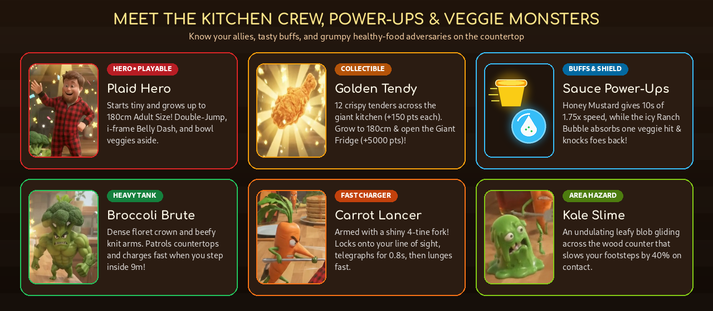

<p align="center">
  
</p>

<p align="center">
  <a href="https://sircharlesxx.github.io/tendy-quest/">
    
  </a>
</p>

<p align="center">
  <a href="https://sircharlesxx.github.io/tendy-quest/"></a>
  
  
  
  
</p>

---

## About the Game

Start shrunk down to miniature **17cm Tiny Toy** size (`0.55` scale) on a colossal **Giant Kitchen** countertop as the **Plaid Hero**! Armed with a red-and-black buffalo plaid onesie, acrobatic **Double-Jumps**, and an invulnerable **Belly Dash**, your mission is to eat all **12 Golden Tendies** across a multi-scale Katamari-style room—climbing from countertops and the giant toaster up to the shelf, across the cutting-board bridge to the center island, and down stepping stools, dining chair, and table to the **kitchen floor**.

Each Golden Tendy physically grows your hero taller, faster, and stronger—scaling jump height, pickup reach, and camera pullback all the way up to **180cm Full Adult Size** (`6.0` scale), where you can bowl Veggie Monsters straight out of your path and pull open the towering **Giant Refrigerator** on the floor!

<table>
  <tr>
    <td valign="top">
      <h3>Core Gameplay Loop</h3>
      <ul>
        <li><strong>Eat-to-Grow Across 12 Golden Tendies:</strong> Hunt down floating crispy tenders across the prep countertop, toaster &amp; upper shelf, island bridge, stools, dining table &amp; chair, and floor (<code>+150 pts</code> each, <code>+1,000 pts</code> bonus when reaching <code>12/12</code>).</li>
        <li><strong>Scale Up &amp; Turn the Tables:</strong> Once your hero grows past <code>2.2</code> scale, you shrug off Kale Slime slowdowns and bowl over Broccoli Brutes &amp; Carrot Lancers on contact (<code>+250 pts</code>)!</li>
        <li><strong>Open the Giant Refrigerator:</strong> Reach <strong>180cm Adult Size</strong> (<code>12/12</code> Tendies), drop down to the kitchen floor, and approach the Giant Fridge handle to swing its stocked door wide open (<code>+5,000 pts</code> Stage Clear!).</li>
        <li><strong>Survive 3 Escalating Waves:</strong> Reinforcements arrive every 16 seconds across the countertop, center island, and kitchen floor.</li>
        <li><strong>Instant Browser &amp; Mobile Play:</strong> Compiles to Rust + WebAssembly + WebGL2 with responsive <code>100dvh</code> portrait/landscape HUD and multi-touch controls tested on Pixel 11 viewports.</li>
      </ul>
    </td>
    <td width="250" align="center" valign="middle">
      
      <br/>
      <sub><em>Inspired by the Giant Kitchen concept video</em></sub>
    </td>
  </tr>
</table>

---

## Screenshots — Desktop & Mobile Touch

Play seamlessly on a widescreen desktop browser or straight from your phone's touchscreen with zero downloads:

<p align="center">
  
</p>

---

## Characters, Power-Ups & Veggie Monsters

<p align="center">
  
</p>

| Entity | Role | Mechanics & Stats |
| :--- | :--- | :--- |
| **Plaid Hero** | Playable Hero | Starts with **5 Hearts** at **17cm Tiny Toy** (`0.55` scale) and grows to **180cm Adult** (`6.0` scale). Features size-scaled speed, **Double-Jump**, a regenerating **Belly Dash**, and a celebratory **Victory Dance**. |
| **Golden Tendy** | Growth Collectible | **12 total** spread across countertop, toaster, upper shelf, island, stepping stools, dining chair/table, and floor (`+150 pts` each). Reaching `12/12` unlocks the **Giant Refrigerator** door goal (`+5,000 pts`). |
| **Giant Refrigerator** | Final Goal | Towering floor-level fridge at `(13.5, -6.0, -18.5)` with hinged stocked door. Only **Full Adult Size** (`12/12` Tendies) is tall enough to swing it open and trigger **Stage Clear**! |
| **Honey Mustard Cup** | Speed Power-Up | Grants **10 seconds** of **1.75× movement speed** for zooming past hazards and grabbing out-of-reach tendies. |
| **Ranch Shield** | Defense Power-Up | Surrounds you in a creamy **1-hit protective bubble** that absorbs incoming veggie damage and knocks attackers back. |
| **Broccoli Brute** | Heavy Tank | Patrols key routes at 2.2 speed and charges aggressively (3.8 speed) whenever you enter its **9.0m** range. |
| **Carrot Lancer** | Fast Charger | Locks onto your line of sight within **10.5m**, **telegraphs for 0.8s** with raised fork, then **lunges at 11.5 speed** before a brief stun recovery. |
| **Kale Slime** | Area Denial Hazard | Glides along the countertop dropping temporary **Fiber Puddles** every 1.4s that slow your footsteps by **40%**. |

---

## Controls Guide

| Desktop (Mouse + Keyboard) | Mobile / Tablet (Touch Screen) |
| :--- | :--- |
| <ul><li>**Move:** `W A S D` or Arrow Keys</li><li>**3D Camera Look:** Move Mouse (`Click` locks cursor, `Esc` unlocks)</li><li>**Camera Zoom:** Mouse Scroll Wheel</li><li>**Jump / Double-Jump:** `Space`</li><li>**Belly Dash:** `Shift` (Left or Right)</li><li>**Controls / Tutorial:** `H`</li><li>**Mute / Unmute Audio:** `M`</li><li>**Start / Play Again:** `Space`, `Enter`, or `Click` button</li></ul> | <ul><li>**Move:** Bottom-left **Virtual Thumbstick** (full 360° analog speed)</li><li>**3D Camera Look:** **Swipe / Drag** anywhere on the viewport (simultaneous with walking!)</li><li>**Jump / Double-Jump:** Tap the golden **JUMP** button</li><li>**Belly Dash:** Tap the cyan **DASH** button</li><li>**Controls / Tutorial:** Tap **HELP** pill</li><li>**Mute / Unmute Audio:** Tap **SOUND** pill</li><li>**Start / Play Again:** Tap **anywhere** on the overlay</li></ul> |

---

## Music & Sound Effects

Tendy Quest features a custom WebAudio soundtrack and positional SFX pipeline wired from Rust via `wasm-bindgen` (automatically unlocked on your first click, key press, or touch):

- **Background Music:** [`assets/audio/tendies_from_the_sun.mp3`](assets/audio/tendies_from_the_sun.mp3) — upbeat 16-bar **125 BPM Bubblegum Pop** synth loop.
- **Kitchen Ambience:** [`assets/audio/kitchen_ambience.mp3`](assets/audio/kitchen_ambience.mp3) — crossfade-looped room ambience extracted from the reference kitchen clip.
- **11 Stereo Sound Effects (`.wav`):** `jump`, `double_jump`, `dash`, `tendy`, `powerup`, `hit`, `shield`, `step`, `lunge`, `win`, and `lose`.

---

## Tech Stack & Building from Source

- **Engine:** [Rust](https://www.rust-lang.org/) + [Bevy 0.15](https://bevyengine.org/) (`webgl2`, `bevy_gltf`, `bevy_pbr`, `bevy_ui`)
- **Web Packaging:** [`trunk`](https://trunkrs.dev/) + `wasm-bindgen` deploying static artifacts from `dist/web/` to GitHub Pages
- **3D & Media Pipeline:** Python-scripted Blender 5.x procedural PBR `.glb` models ([`blender/build_tendy_quest_assets.py`](blender/build_tendy_quest_assets.py)), NumPy/`ffmpeg` audio synthesis ([`blender/build_tendy_quest_audio.py`](blender/build_tendy_quest_audio.py)), and Pillow/`ffmpeg` README graphics ([`blender/build_readme_graphics.py`](blender/build_readme_graphics.py))

### Prerequisites

```bash
rustup target add wasm32-unknown-unknown
cargo install trunk
```

### Run Locally in Your Browser

```bash
cd rust
trunk serve
```

### Build Production GitHub Pages Bundle (`dist/web/`)

```bash
cd rust
trunk build --release --public-url ./ --dist ../dist/web
```

### Regenerate 3D Models, Audio & README Graphics (Optional)

```bash
# Regenerate all 14 articulated PBR .glb models in assets/models/
blender --background --python blender/build_tendy_quest_assets.py

# Regenerate background music & 11 stereo SFX in assets/audio/
python3 blender/build_tendy_quest_audio.py

# Regenerate README banners, showcase panels & GIF in assets/readme/
python3 blender/build_readme_graphics.py
```

---

<p align="center">
  <strong>Grab a golden tendy and watch out for steamed veggies!</strong><br/>
  <a href="https://sircharlesxx.github.io/tendy-quest/">Play Tendy Quest Live &rarr;</a>
</p>
