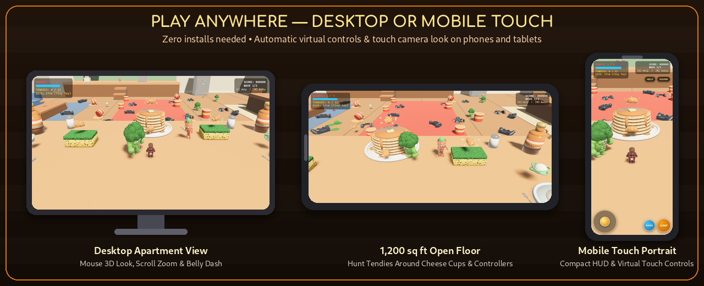
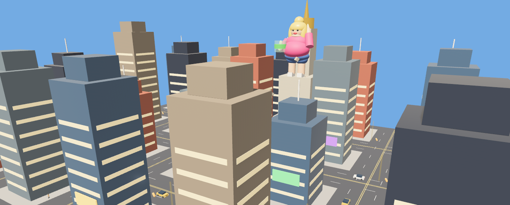

<p align="center">
  
</p>

<p align="center">
  <a href="https://sircharlesxx.github.io/tendy-quest/">
    
  </a>
</p>

<p align="center">
  <a href="https://sircharlesxx.github.io/tendy-quest/"></a>
  
  
  
  
</p>

---

## Welcome to Tendy Quest! (Eat Tendies, Grow Into a Big Boy)

Start shrunk down to miniature **17cm Tiny Toy** size (`0.55` scale) right next to a stack of pancakes on the **Breakfast Island** of a massive **1,200 sq ft Open-Concept Apartment**! As **Stan (the Plaid Hero)**, you've got cozy red-and-black buffalo plaid pajamas, springy **Double-Jumps**, a speedy **Belly Dash**, and one simple mission: **eat all 12 Golden Tendies and grow up to be a Big Boy!**

Every crispy chicken tender you gobble down physically stretches Stan taller, faster, and stronger—scaling jump height, pickup reach, and camera pullback step by step until you hit **180cm Full Adult Size** (`6.0` scale). Once you're a full-grown Big Boy, grumpy veggies bounce right out of your way and you're finally tall enough to swing open the **Giant Refrigerator**!

<table>
  <tr>
    <td valign="top">
      <h3>Core Eat-to-Grow Gameplay</h3>
      <ul>
        <li><strong>Hunt 12 Golden Tendies Across 1,200 Sq Ft:</strong> Leap around the South Breakfast Island, bound down to the sprawling hardwood floor, weave through the Living Room and Dining Area, and climb back up the North Kitchen Countertop (<code>+150 pts</code> per tendy, plus a <code>+1,000 pts</code> Big Boy bonus at <code>12/12</code>).</li>
        <li><strong>Grow From Little Guy to 180cm Big Boy:</strong> Watch Stan level up from <strong>Tiny Toy</strong> (<code>0–3</code> Tendies) &rarr; <strong>Counter Climber</strong> (<code>4–7</code>) &rarr; <strong>Kid Size</strong> (<code>8–11</code>) &rarr; <strong>180cm Big Boy</strong> (<code>12/12</code>).</li>
        <li><strong>Turn the Tables on Veggies:</strong> Once Stan grows past <code>2.2</code> scale, he shrugs off sticky Kale Slime puddles and bowls Broccoli Brutes &amp; Carrot Lancers right across the room on contact (<code>+250 pts</code>)!</li>
        <li><strong>Open the Giant Refrigerator:</strong> At full <strong>180cm</strong> height, walk right up to the towering fridge on the north side of the apartment and yank its door wide open (<code>+5,000 pts</code>)!</li>
        <li><strong>Navigate Apartment Clutter &amp; 3 Veggie Waves:</strong> Hop over scattered <strong>Ricos Nacho Cheese Cups</strong>, wireless <strong>Game Controllers</strong>, and floor <strong>Headphones</strong> while veggie reinforcements spawn up to Wave 3 every 16 seconds.</li>
      </ul>
    </td>
    <td width="250" align="center" valign="middle">
      
      <br/>
      <sub><em>Stan gearing up for snack time</em></sub>
    </td>
  </tr>
</table>

### Growth Milestones

| Tendies Eaten | Size Tier | Stan's Height | What Changes |
| :---: | :--- | :--- | :--- |
| `0 – 3` | **Tiny Toy** | Starts at **17cm** (`0.55` scale) | Cozy bite-sized adventurer dodging towering forks and giant pancakes. |
| `4 – 7` | **Counter Climber** | Climbing upward | Faster stride, higher jumps, and wider reach across apartment furniture. |
| `8 – 11` | **Kid Size** | Past `2.2` scale | Sticky Kale Slime puddles stop slowing you down, and veggies get knocked flying! |
| `12 / 12` | **ADULT - OPEN FRIDGE!** | **180cm Big Boy** (`6.0` scale) | Full grown! Tall enough to reach the handle on the **Giant Refrigerator**. |

---

## Play Anywhere — Desktop & Mobile Touch

Hop straight in with zero downloads! Compiled to Rust + WebAssembly + WebGL2 with responsive `100dvh` portrait/landscape layouts, scroll-wheel zoom on desktop, and touch controls tested on Pixel 11 phones:

<p align="center">
  
</p>

---

## Meet Stan, Sauce Buffs & the Grumpy Veggies

<p align="center">
  
</p>

| Entity | Role | Mechanics & Stats |
| :--- | :--- | :--- |
| **Stan (Plaid Hero)** | Playable Hero | Starts with **5 Hearts** at **17cm Tiny Toy** size and grows into a **180cm Big Boy** (`6.0` scale). Features size-scaled speed, **Double-Jump**, a regenerating **Belly Dash**, and a celebratory **Victory Dance**. |
| **Golden Tendy** | Growth Snack | **12 total** hidden across the Breakfast Island, 1,200 sq ft floor, and Kitchen Counter (`+150 pts` each). Collect `12/12` to reach full **180cm** height! |
| **Giant Refrigerator** | Apartment Goal | Towering fridge waiting by the North Kitchen wall—only a full-grown **180cm Big Boy** can reach high enough to swing open the door (`+5,000 pts`)! |
| **Honey Mustard Cup** | Speed Buff | Grants **10 seconds** of **1.75&times; movement speed** for zooming across the apartment floor. |
| **Ranch Bubble Shield** | Defense Buff | Wraps Stan in a creamy **1-hit protective bubble** that absorbs veggie damage and knocks attackers back. |
| **Broccoli Brute** | Heavy Tank | Patrols key apartment zones at `2.2` speed and charges at `3.8` speed whenever Stan enters its `9.0m` range. |
| **Carrot Lancer** | Fast Charger | Locks on within `10.5m`, telegraphs for `0.8s`, and lunges forward at `11.5` speed with a 4-tine fork! |
| **Kale Slime** | Floor Hazard | Glides around leaving sticky **Fiber Puddles** every `1.4s` that slow down tiny Stan (until he grows big enough to brush them off). |
| **Apartment Floor Clutter** | Obstacles | Randomized **Ricos Nacho Cheese Cups** (upright &amp; spilled!), **Game Controllers**, and **Headphones** scattered across the 1,200 sq ft apartment—watch your step! |

---

## Future Mechanic Sneak Peek — Heading Out to the City to Meet Friends

<p align="center">
  
</p>

<p align="center">
  <sub><em>A work-in-progress glimpse beyond the apartment doors!</em></sub>
</p>

As an upcoming future mechanic once Stan finishes eating all his apartment tendies and grows into a proper **Big Boy**, the adventure will continue outside into the wider city where Stan can explore bustling streets and **meet up with his friends**!

---

## Controls Guide

| Desktop (Mouse + Keyboard) | Mobile / Tablet (Touch Screen) |
| :--- | :--- |
| <ul><li>**Move:** `W A S D` or Arrow Keys</li><li>**3D Camera Look:** Move Mouse (`Click` locks cursor, `Esc` unlocks)</li><li>**Camera Zoom:** Mouse Scroll Wheel</li><li>**Jump / Double-Jump:** `Space`</li><li>**Belly Dash:** `Shift` (Left or Right)</li><li>**Controls / Tutorial:** `H`</li><li>**Mute / Unmute Audio:** `M`</li><li>**Start / Play Again:** `Space`, `Enter`, or `Click` button</li></ul> | <ul><li>**Move:** Bottom-left **Virtual Thumbstick** (full 360&deg; analog speed)</li><li>**3D Camera Look:** **Swipe / Drag** anywhere on the viewport (simultaneous with walking!)</li><li>**Camera Zoom:** Two-finger **Pinch** (active when thumbstick is released)</li><li>**Jump / Double-Jump:** Tap **JUMP**</li><li>**Belly Dash:** Tap **DASH**</li><li>**Controls / Tutorial:** Tap **HELP**</li><li>**Mute / Unmute Audio:** Tap **SOUND**</li><li>**Start / Play Again:** Tap **anywhere** on the overlay</li></ul> |

---

## Music & Sound Effects

Tendy Quest includes a custom WebAudio soundtrack and positional SFX pipeline wired from Rust via `wasm-bindgen` (unlocked automatically on your first click, keypress, or tap):

- **Background Music:** [`assets/audio/tendies_from_the_sun.mp3`](assets/audio/tendies_from_the_sun.mp3) — upbeat Bubblegum Pop synth loop.
- **Apartment Ambience:** [`assets/audio/kitchen_ambience.mp3`](assets/audio/kitchen_ambience.mp3) — crossfade-looped room ambience.
- **11 Stereo Sound Effects (`.wav`):** `jump`, `double_jump`, `dash`, `tendy`, `powerup`, `hit`, `shield`, `step`, `lunge`, `win`, and `lose`.

---

## Tech Stack & Building from Source

- **Engine:** [Rust](https://www.rust-lang.org/) + [Bevy 0.15](https://bevyengine.org/) (`webgl2`, `bevy_gltf`, `bevy_pbr`, `bevy_ui`)
- **Web Packaging:** [`trunk`](https://trunkrs.dev/) + `wasm-bindgen` deploying static artifacts from `dist/web/` to GitHub Pages
- **3D & Media Pipeline:** Python-scripted Blender PBR `.glb` models ([`blender/build_tendy_quest_assets.py`](blender/build_tendy_quest_assets.py)), NumPy/`ffmpeg` audio synthesis ([`blender/build_tendy_quest_audio.py`](blender/build_tendy_quest_audio.py)), and Pillow/`ffmpeg` README graphics ([`blender/build_readme_graphics.py`](blender/build_readme_graphics.py))

### Prerequisites

```bash
rustup target add wasm32-unknown-unknown
cargo install trunk
```

### Run Locally in Your Browser

```bash
cd rust
trunk serve
```

### Build Production GitHub Pages Bundle (`dist/web/`)

```bash
cd rust
trunk build --release --public-url ./ --dist ../dist/web
```

### Regenerate 3D Models, Audio & README Graphics (Optional)

```bash
# Regenerate all articulated PBR .glb models in assets/models/
blender --background --python blender/build_tendy_quest_assets.py

# Regenerate background music & 11 stereo SFX in assets/audio/
python3 blender/build_tendy_quest_audio.py

# Regenerate README banners, showcase panels, city preview & GIF in assets/readme/
python3 blender/build_readme_graphics.py
```

---

<p align="center">
  <strong>Grab a golden tendy, grow into a Big Boy, and watch out for steamed veggies!</strong><br/>
  <a href="https://sircharlesxx.github.io/tendy-quest/">Play Tendy Quest Live &rarr;</a>
</p>
